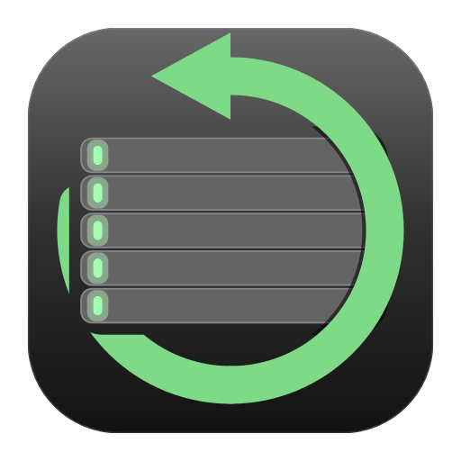
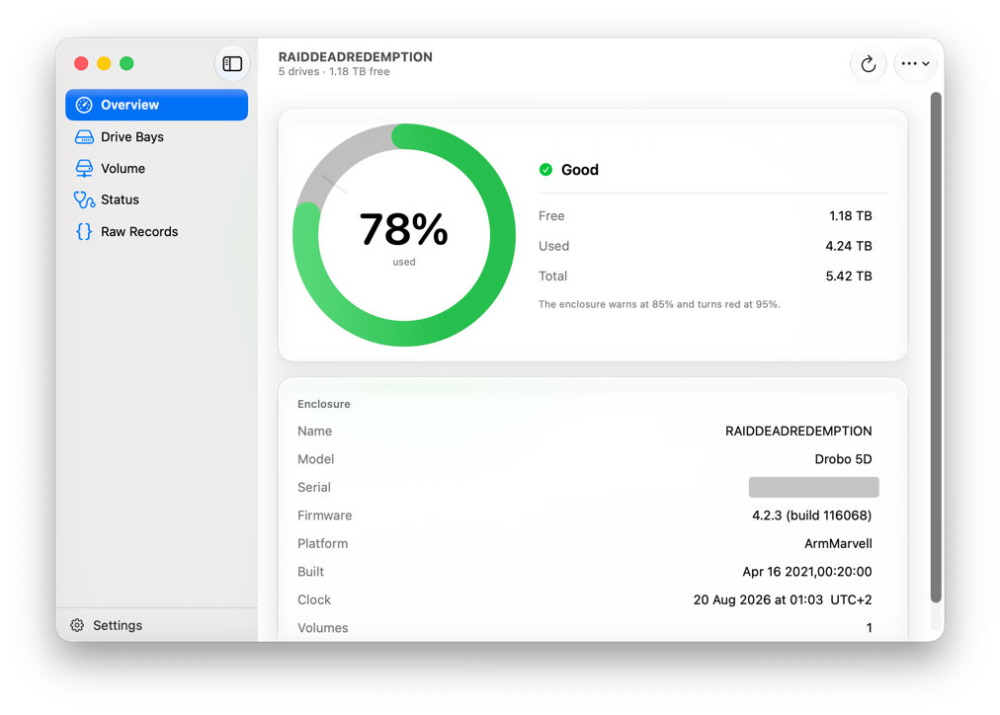
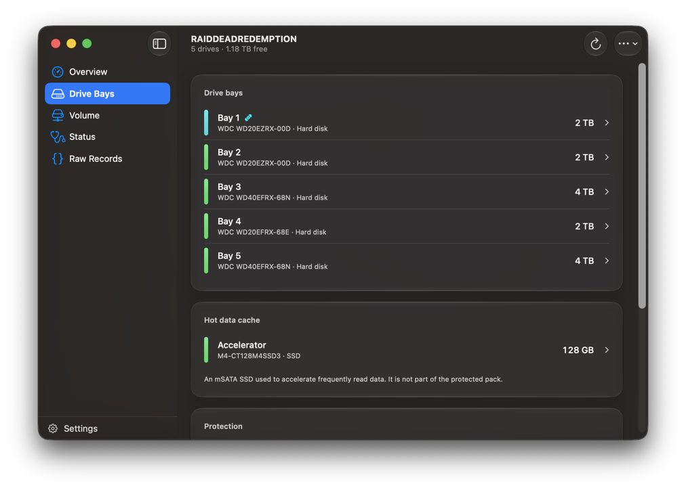

<h1> ReDrobo</h1>

Reads a Drobo over USB and tells you what is actually inside it: real capacity,
drive bays, per-disk health. More or less what Drobo Dashboard used to show,
except on the Macs Dashboard stopped running on.

Drobo went into liquidation in 2023. The last Dashboard shipped in February
2021, tops out at macOS 11, is Intel-only, and leans on a kernel extension
nobody can sign or fix any more.

The enclosures themselves are fine. Over USB a Drobo mounts on any Mac without
help: what you lose is everything else (real capacity, bay status, health,
alerts). And that first one is not a detail. macOS will cheerfully tell you
there are 16 TB free on an array with 1.18 TB left, because a Drobo advertises
a thin-provisioned volume and keeps the truth on a management channel that
nothing on a modern Mac can speak.

ReDrobo speaks it again, with a DriverKit driver extension instead of a kext.

## Screenshots



*Capacity against the yellow and red thresholds the enclosure keeps for itself,
and its own verdict on its own health.*



*The five bays with model and size, and the mSATA accelerator listed apart from
them (it is a cache, not part of the protected pack). Each row opens for health,
serial, firmware revision and wear.*

## What it shows

- Real capacity (free/used/total) against the yellow and red thresholds the
  enclosure keeps for itself
- Every drive bay: model and capacity, plus health, error count, serial number,
  firmware revision and wear where the firmware answers for them
- The status word decoded bit by bit against Drobo's own alert code, rather
  than guessed at
- The gap between what macOS believes and what the array has
- A menu bar item, and notifications when something changes (as opposed to
  notifications when something merely is)

## Installing

Grab the zip from the [releases page](https://github.com/fetzu/ReDrobo/releases),
then:

1. Unzip it and move `ReDrobo.app` into `/Applications`. macOS refuses to
   activate a driver extension carried by an app anywhere else, so this one is
   not negotiable.
2. Open it. The setup assistant asks you to approve the driver under System
   Settings ▸ General ▸ Login Items & Extensions ▸ Driver Extensions.
3. Restart the Mac. Until you do, the system keeps running whatever driver it
   was running before, which is usually none at all.

That is all of it. System Integrity Protection stays on, no boot-args, no
developer account, nothing to sign yourself and nothing about the machine to
weaken: the releases are signed with a Developer ID certificate and notarized,
so they install on a Mac in the state Apple shipped it. That needed the managed
DriverKit entitlements, which Apple grants by hand and took three weeks to
arrive; they landed on 10.09.2026 and every release since is built, signed,
notarized and stapled off a tag by
[CI](.github/workflows/release.yml).

Universal (Apple Silicon and Intel), macOS 26 or newer. Which is the point,
really: the Intel Macs stuck without a Dashboard are the ones that needed this.

Building and signing it yourself is still perfectly possible and is
[further down](#building).

## Caveats

**It has been tested on exactly one enclosure**, a Drobo 5D on firmware 4.2.3,
by one person. The driver carries all 26 Vendor/Product pairs Drobo's own kext
matched on, so the other USB models should be picked up.. should, not does. The
Thunderbolt and iSCSI ones cannot work at all (they needed a virtual SCSI HBA
kext, and DriverKit has no equivalent).

**It only reads.** No settings, no rename, no standby, no format, no firmware
update. The write protocol is decoded and deliberately not implemented; the
reasoning is in [docs/WRITING.md](docs/WRITING.md).

**Some of it is inference, and it says so.** Most of the protocol was recovered
from Drobo's own binaries rather than guessed at, but not all of it has been
confirmed against hardware, so [docs/PROTOCOL.md](docs/PROTOCOL.md) rates every
claim as confirmed / high confidence / open. Two examples: single versus dual
redundancy is derived from the capacities (no record reports it), and firmware
4.2.3 returns zero for every disk temperature, so the app shows nothing rather
than pretend your array is freezing.

**It cannot save your data.** BeyondRAID is undocumented and a disk pack can
only be read by another Drobo, so if the enclosure dies nothing here helps.
Keep a backup that is not on a Drobo: that was true before Drobo folded, and it
is more true now.

## Project status

Done, for now. It reads the array, it ships signed, it installs on a Mac nobody
had to tamper with first, and that was the entire brief – so no further
development is planned.

Which is not the polite version of "abandoned": the thing runs here every day,
and if I get an itch I will pick it back up for fun (feature-flag writes are
already decoded and would be the obvious place to start, see
[docs/WRITING.md](docs/WRITING.md)). Just do not hold your breath waiting for a
roadmap, because there is none.

Issues and pull requests are welcome, answers may be slow. The single most
useful thing anybody can send is a report from a model that is *not* a 5D:
26 Vendor/Product pairs are in the driver and exactly one of them has ever met
a real enclosure.

## If all you want is the real free space

Then you do not need any of this. macOS reports *used* space correctly, only
the total is hidden, and the total only changes when you swap a disk:

```bash
python3 tools/drobo-space.py --set-total <bytes> --volume /Volumes/YourDrobo
python3 tools/drobo-space.py
```

No driver, no restart, no app. It will not tell you about a failing disk, but
it does stop the array filling up behind your back, which is the part that
actually bites.

## Building

You need Xcode 26 and a paid Apple Developer account. The development DriverKit
capabilities are self-serve (nothing to request, nobody to wait for, about an
hour on Apple's portal), and a development build installs with SIP on just like
a release one: the profile lists the Macs it may run on, and that is what macOS
trusts. Put the two provisioning profiles next to the Makefile first (see
[docs/DRIVERKIT.md](docs/DRIVERKIT.md)): `make` embeds them if it finds them,
and tells you what happens if it does not.

```bash
cd ReDrobo && make && make install
```

Then open `/Applications/ReDrobo.app` and follow the setup assistant. The Mac
has to be restarted once the driver is installed, because macOS keeps running
the previous one until it is (this costs a debugging round roughly every time
you forget).

Other targets: `make check` runs the offline checks over the record decoding,
the status word tables and the redundancy derivation (no hardware needed),
`make icon` regenerates the app icon, `make signing` shows what got signed and
the state of the machine, and `make RELEASE=1 notarize` does the Developer ID
build, once you have managed entitlements of your own.

There is one more way in, for the record: SIP off and AMFI told to look the
other way, which needs no account at all. It is how this was developed before any of
the paperwork existed, it works for anybody, and it is a real reduction in
security for the whole machine rather than for ReDrobo alone. There is now no
good reason to take it. [docs/TESTING.md](docs/TESTING.md) has it anyway,
including how to put the Mac back afterwards.

## Documentation

- [CHANGELOG.md](CHANGELOG.md): what changed in each of the three releases.
- [docs/PROTOCOL.md](docs/PROTOCOL.md): the management protocol, field by
  field, with a confidence rating on every claim.
- [docs/DRIVERKIT.md](docs/DRIVERKIT.md): getting a SCSI peripheral dext to
  work, and the traps that cost a day each.
- [docs/PROVISIONING.md](docs/PROVISIONING.md): signing it yourself, step by
  step, the portal traps that are documented nowhere, and what changes once
  Apple grants the managed entitlements.
- [docs/TESTING.md](docs/TESTING.md): setting a Mac up to load a build you made
  yourself, and putting it back afterwards.
- [docs/WRITING.md](docs/WRITING.md): the write path, decoded, and why none of
  it is implemented.
- [docs/TEARDOWN.md](docs/TEARDOWN.md): what the original Dashboard was made of.

## Licence

MIT. Not affiliated with Drobo, Inc. or its successors: "Drobo" is used here
only to say what this thing talks to.
